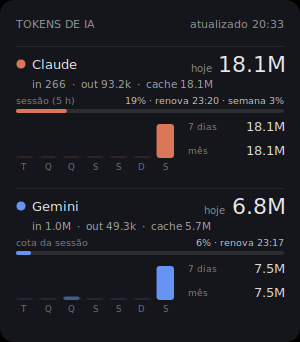
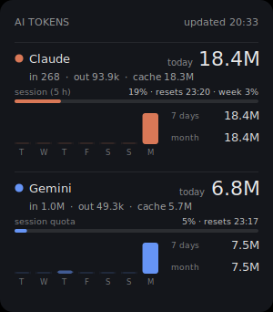
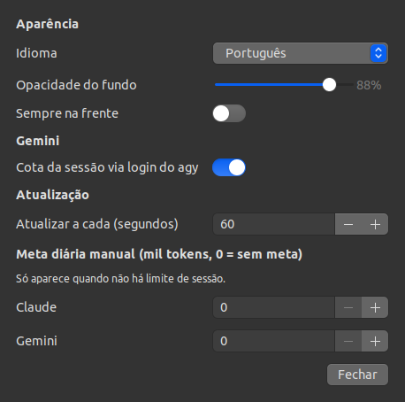

# Token Widget

Widget de desktop (GNOME/X11) que mostra quantos tokens de IA você gastou hoje, nos últimos 7 dias e no mês, separado entre **Claude** e **Gemini**, e quanto já usou da cota da sessão de cada um. Interface em português e inglês.

| Português | English |
|---|---|
|  |  |



## Como rodar

### Requisitos

- Linux com GNOME em sessão **X11** (no Ubuntu, "Ubuntu on Xorg" na tela de login).
- Python do sistema (`/usr/bin/python3`) com GTK3. Já vem no Ubuntu; se faltar:

```sh
sudo apt install python3-gi gir1.2-gtk-3.0
```

- Opcional, para a cota do Gemini: `gir1.2-secret-1` (acesso ao chaveiro do sistema).

```sh
sudo apt install gir1.2-secret-1
```

- Claude Code e/ou Antigravity CLI (`agy`) instalados e já usados. O widget lê os arquivos que eles gravam.

### Instalar e abrir

```sh
git clone https://github.com/ronaldandrade/token-widget.git
cd token-widget
./install.sh
token-widget
```

O `install.sh`:

- confere as dependências e avisa se a sessão for Wayland;
- cria o comando `token-widget` (link em `~/.local/bin`) e a abertura automática no login do GNOME (`~/.config/autostart/token-widget.desktop`);
- pergunta se deve configurar a status line do Claude Code (ver abaixo). Se você já tiver uma status line, ele não mexe nela e mostra o comando para trocar à mão.

Para abrir sem instalar: `./token-widget`.

### Usar

- Arraste com o botão esquerdo para mover (a posição fica salva).
- Botão direito: **Configurações…**, **Sempre na frente**, **Atualizar**, **Sair**.
- Atualiza sozinho a cada 60 s (ajustável).

### Limite da sessão do Claude (status line)

O Claude Code só entrega o uso da sessão de 5 h e da semana para scripts de status line. O `install.sh` configura isso; para fazer à mão, adicione em `~/.claude/settings.json` (trocando o caminho pelo da sua cópia):

```json
"statusLine": {
  "type": "command",
  "command": "/usr/bin/python3 /caminho/para/token-widget/token_widget/claude_statusline.py",
  "refreshInterval": 60
}
```

A linha aparece embaixo do Claude Code (`Opus 5.5 | sessão 11% · renova 23:20 | semana 1%`) e o dado é gravado em `~/.cache/token-widget/claude-limits.json` para o widget. Precisa de assinatura Pro ou Max: com chave de API o Claude Code não manda esse dado.

### Cota da sessão do Gemini (desligada por padrão)

Ligue em **Configurações… → Gemini → Cota da sessão via login do agy**.

> **Atenção:** com essa opção ligada, o widget lê o login do Antigravity CLI no chaveiro do sistema e usa esse token para consultar a cota no Google, pelos mesmos endpoints que o `agy` usa. Esses endpoints **não são documentados** e podem mudar ou parar de funcionar sem aviso. O token só é usado para essa consulta e não é copiado para nenhum arquivo.

## Estrutura

```
token-widget/
├── token-widget              # launcher: roda o pacote com /usr/bin/python3
├── install.sh                # comando, autostart e status line do Claude Code
├── LICENSE                   # MIT
├── docs/                     # capturas usadas neste README
└── token_widget/
    ├── widget.py             # janela GTK, desenho com cairo, menu e timers
    ├── settings.py           # janela de Configurações
    ├── i18n.py               # textos em português e inglês
    ├── collectors.py         # lê o uso de tokens do Claude Code e do Antigravity
    ├── protobuf.py           # decodificador mínimo de protobuf (sem schema)
    ├── stats.py              # soma hoje / 7 dias / mês e formata os números
    ├── claude_statusline.py  # status line do Claude Code; grava o limite da sessão
    └── gemini_quota.py       # consulta a cota do Gemini com o login do agy
```

## Como funciona

**Tokens.** O widget lê direto os arquivos locais, sem chave de API:

| Fonte | Arquivos lidos |
|---|---|
| Claude Code | `~/.claude/projects/**/*.jsonl` (campo `message.usage`) |
| Gemini (Antigravity CLI) | `~/.gemini/antigravity-cli/conversations/*.db` (SQLite com protobuf) |

- Claude: cada resposta aparece em várias linhas do JSONL com o mesmo `message.id`; fica uma por id.
- Antigravity: na tabela `steps`, o campo 9 do blob `metadata` traz o uso de cada chamada ao modelo (2 = entrada, 3 = saída, 5 = cache). O campo 1 é o horário.
- Os arquivos são relidos só quando mudam (cache por arquivo + data de modificação).

**Limite da sessão.**

- Claude: `claude_statusline.py` recebe do Claude Code o JSON com `rate_limits` (porcentagem usada e horário de renovação das janelas de 5 h e 7 dias) e grava em `~/.cache/token-widget/claude-limits.json`. Só atualiza enquanto o Claude Code está aberto.
- Gemini: `gemini_quota.py` lê o token OAuth do `agy` no chaveiro (serviço `gemini`, usuário `antigravity`), chama `loadCodeAssist` e `fetchAvailableModels` em `daily-cloudcode-pa.googleapis.com` com o User-Agent do antigravity e pega a menor `remainingFraction` entre os modelos Gemini, que dividem a mesma cota. Roda a cada 5 min numa thread e grava `~/.cache/token-widget/gemini-quota.json`.
- A barra fica amarela a partir de 80% e vermelha em 100%. Quando o horário de renovação passa, o widget mostra "renovada" até chegar um dado novo.
- Sem limite de sessão disponível, vale a meta diária manual, se configurada.

**Idioma.** Os textos ficam em `i18n.py`. Com `language` em `"auto"`, o widget segue o idioma do sistema (`LANGUAGE`/`LANG`): português se começar com `pt`, inglês nos outros casos. A status line do Claude Code segue sempre o idioma do sistema.

**Configuração.** Pela janela **Configurações…** dá para ajustar idioma, opacidade, "sempre na frente", a cota do Gemini, o intervalo de atualização e a meta diária; tudo é aplicado na hora. Os valores ficam em `~/.config/token-widget/config.json`, que também pode ser editado à mão (feche e abra o widget depois):

```json
{
  "refresh_seconds": 60,
  "opacity": 0.88,
  "always_on_top": false,
  "language": "auto",
  "gemini_quota": false,
  "gemini_model_names": { "1418": "Gemini 3.8 Flash" },
  "daily_budget": { "claude": 2000000, "gemini": 500000 }
}
```

- `gemini_model_names`: o Antigravity guarda o modelo como número; aqui você dá nome a ele (o widget ainda não mostra o modelo).
- `daily_budget`: meta diária de tokens; aparece como barra só quando não há limite de sessão.

## Limitações

- Testado só no Ubuntu com GNOME em X11. No Wayland, mover, fixar no fundo e lembrar a posição podem não funcionar.
- O formato do Antigravity não é documentado. Os campos (`input`, `output`, `cache`) foram descobertos lendo o protobuf; se uma atualização do CLI mudar o formato, o Gemini pode aparecer zerado.
- Cota do Gemini: o token do `agy` dura cerca de 1 h e só o `agy` o renova. Com o `agy` fechado por mais tempo, o widget mostra o último valor, marcado como "dado antigo".
- Cota do Gemini: endpoints não oficiais; podem mudar sem aviso.
- Limite do Claude: depende da status line e de assinatura Pro/Max; só atualiza com o Claude Code aberto.
- Os limites são porcentagens. Nenhuma das ferramentas informa quantos tokens cabem numa sessão.


## Licença

MIT. Pode usar, modificar e redistribuir, mantendo o aviso de copyright do arquivo `LICENSE`.
